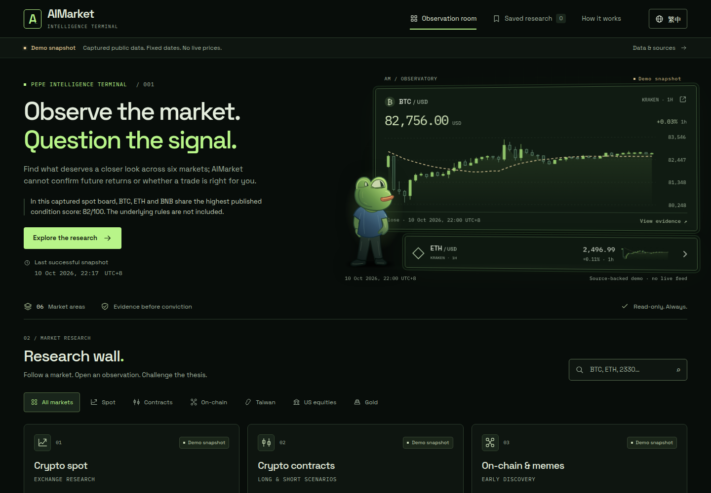

# AIMarket — Pepe Intelligence Terminal

An independent, runnable Vite / React / TypeScript redesign experiment. It turns six dated research boards into a searchable observation room with an original SVG frog, completed-candle charts, evidence details and a local watchlist. It does not modify or connect to any owner service.



## Run it

Use Node.js **22.12 or newer** (this run used 24.21.0).

```sh
npm ci
npm run dev
```

For the exact static deliverable:

```sh
npm run build
npm run preview -- --port 4173
```

Then open `http://127.0.0.1:4173/`. The preview exists only while that command is running. `dist/index.html`, JavaScript, CSS, fonts, favicon and observer artwork are all included. No API server is required. Use an HTTP server or IPFS gateway, rather than opening an ES-module site through `file://`.

## Inspect the experience

1. Read the dated brief and its **Demo snapshot** label. Select BTC or ETH on the green wall to inspect a reproducible calculation.
2. Open BTCUSDT from the crypto spot card. The three research questions, source date, missing evaluation date, score limitations, evidence and invalidation are in one detail view.
3. Open ETH-USD from contracts. Both long and short frameworks are shown, explicitly unevaluated because the source supplies no direction or trigger levels.
4. Filter all six markets; search `2330`; try a search with no matches. Gold intentionally has no price or candidate.
5. Save a detail, open **Saved research**, reload, then remove it. Bookmarks stay in this browser.
6. Switch to **繁中**, use Tab / Shift+Tab / Escape, and inspect at a narrow width. The OS reduced-motion preference and the page's **Reduce motion** control both work.
7. In **Data & sources**, optionally load public Kraken BTC/ETH candles. This is a deliberate external request; opening the default page makes **zero external data or font requests**.

## Data and setup

The default build has an isolated, fixed **Demo** fixture. Its numbers were captured from actual public responses on **10 October 2026**, not fabricated. The demo is always an archive, regardless of its age. Older sessions and stale candles carry additional stale labels; nothing here executes a trade.

The isolated-browser check found that AIMarket's overview was inaccessible cross-origin. Its inspected successful HTTP response lacked an `Access-Control-Allow-Origin` header. The default build therefore does not attempt that fetch. [Actual provider check](artifacts/public-provider-check.json).

If a public, authorized base URL later permits this site's origin, configure it at build time without putting secrets in the frontend:

```sh
VITE_PUBLIC_API_BASE_URL=https://aimarket.trade npm run build
```

This setting appends `/api/public/overview`, makes **one credential-free GET per page load**, and never polls. A failed, malformed or inaccessible response falls back to the marked demo with an explanation. The existing production endpoint is only an example of the public schema; its CORS policy was not changed. Leave the variable unset to reproduce the shipped default export. Vite variables are public, embedded build values, never secret storage.

Kraken's optional path works directly in the browser in this run. It needs no backend, key or subscription. It makes at most two GETs per explicit refresh, caches successful responses and throttles failed attempts for 15 minutes in local storage, with an in-memory fallback. There is no network timer. The one-minute local timer only reevaluates age labels while the document is open. Closing the browser stops all activity. Cache limits are per browser, not a shared fleet-wide quota.

See [data contract and provider capabilities](artifacts/DATA.md) for endpoints, capture times, methodology, stale thresholds and limitations.

## Build, typecheck and test

```sh
npm run typecheck
npm test
npm run build
npx playwright install chromium
npm run test:browser
npm run test:overview
npm run check:delivery
```

`test:browser` owns a temporary local server, serves the real export at `/ipfs/aimarket-experiment/`, runs Chromium and shuts both down. It uses mocked provider responses unless explicitly enabled below. It writes actual screenshots and a report in `artifacts/`. `test:overview` builds a separately configured export into disposable `test/scratch/` and verifies success, HTTP error, malformed data and empty data. It never replaces `dist/`.

An optional public-provider verification, limited to this one test run:

```sh
VERIFY_PUBLIC_SOURCES=1 npm run test:browser
```

Actual worker results: **production build passed; TypeScript passed; 12 data tests passed; 15 browser interaction groups passed; 4 configured-overview scenarios passed.** Four axe scans had zero automatic violations; incomplete checks remain documented. These are worker observations, not independent certification. [Full validation and six-domain review](artifacts/validation.md).

The worker respected the protected repository `node_modules/` path by installing its toolchain in `/tmp/aimarket-deps/`. Normal `npm ci` is the supported setup for your own checkout. The optional `AIMARKET_DEPENDENCY_ROOT` build/test override and `AIMARKET_CHROMIUM_PATH` browser override reproduce that constrained environment. No `/tmp` path is embedded in the runtime export. No dependency directory is delivered.

## Publish the static export

Publishing was **not performed**. There is no verified public preview URL or IPFS CID.

- Upload the **contents of `dist/`** to a static host, or add the entire `dist` directory to an IPFS node with `ipfs add -r dist` and pin the returned directory CID using your chosen node/provider.
- Serve `index.html` at the directory root. Preserve the `assets/` directory. Vite's base is `./`; all runtime assets are local and relative. Navigation uses anchors, so no server rewrite rules are needed.
- Inspect a gateway path ending in `/ipfs/<actual-CID>/`, including refresh, fonts, language switch, details and bookmarks. Native IPFS publication was not tested; the equivalent nested HTTP path was tested.
- Default mode works offline once all static files have been obtained. It is not a service worker/PWA and does not promise that an unloaded page will open without a network.

This handoff is for human review. Do not treat its demo fixtures or illustrative futures frameworks as production signals.

## Handoff and source map

| Deliverable | Location |
| --- | --- |
| Implemented design system | [DESIGN.md](DESIGN.md) |
| Baseline and prioritized comparison | [artifacts/COMPARISON.md](artifacts/COMPARISON.md) |
| Provider capabilities and data provenance | [artifacts/DATA.md](artifacts/DATA.md) |
| Validation, findings, fixes and limitations | [artifacts/validation.md](artifacts/validation.md) |
| Desktop / mobile evidence | [Desktop](artifacts/desktop.png), [mobile](artifacts/mobile.png), [Traditional Chinese](artifacts/mobile-zh.png) |
| Calculation / stale policy / normalization | `src/lib/market.ts`, `src/lib/snapshot.ts` |
| Public reads and bounded cache | `src/lib/providers.ts` |
| UI, language copy, tokens | `src/App.tsx`, `src/components/`, `src/i18n.ts`, `src/styles.css` |
| Replaceable observer asset | `public/assets/observer.svg` |
| Source and export integrity | `artifacts/delivery-manifest.json` |

**Repository URL:** unavailable; the supplied checkout has no Git remote. **Exact starting commit:** `0243d7da4a4337ae8b16bcdf15bb4ead736fd68f`. **Delivery commit:** assigned by the contributor submission system, unavailable within this run; `.git/` is protected and was not modified. The final source and export are present and are not ignored. The manifest identifies their exact bytes without claiming an uncreated commit. Obtain the final submission commit from the resulting contributor bundle.

## Package and licensing

The `.gitignore` includes explicit path budgets totalling less than the 8 MiB limit, excludes dependency/cache directories at every nesting level, and explicitly includes `dist/` and required `artifacts/`. The delivery manifest records the final file sizes. No dependency archive, registry mirror, submodule or package cache is needed for rebuilding.

Inside a Git checkout, `npm run check:delivery` reads the candidate file list, enforces the path budgets, hashes the payload and makes a disposable compressed review archive in `test/scratch/`. It does not stage or commit anything. The byte totals include the manifest itself and reserve 917,504 bytes for submission packaging overhead.

New source and original SVG artwork use [MIT](LICENSE). Locally bundled Space Grotesk and IBM Plex Mono retain their SIL Open Font License notices. The Better Interface guidance was applied and its MIT / Apache-2.0 notices are retained. [Attribution and licensing boundaries](artifacts/ATTRIBUTION.md).
